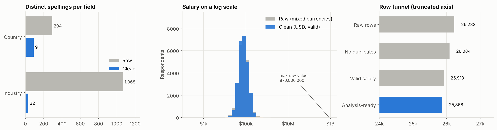
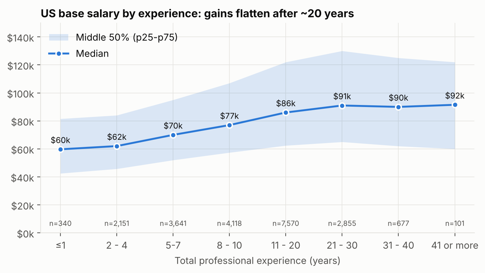
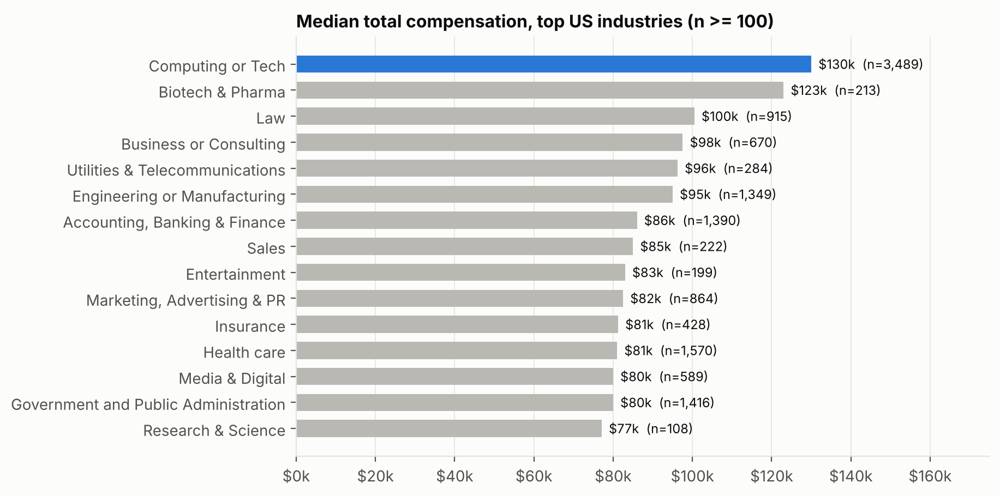
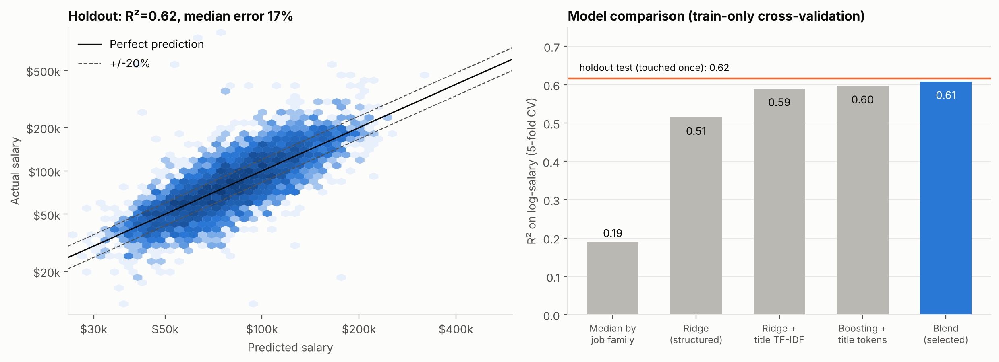
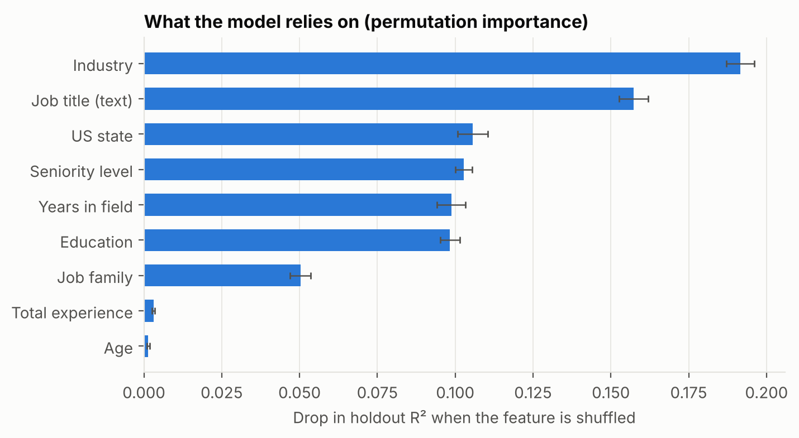
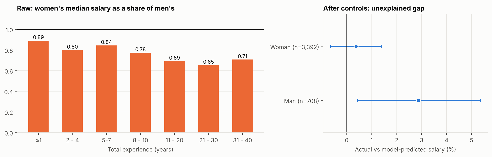

# From 26,000 Messy Survey Responses to a Data Warehouse You Can Trust

**Data Science Portfolio #1: Data Cleansing, ETL, SQL Analytics, and Predictive Modeling**

Michael Anggi G.A. · Dataset: *Ask a Manager Salary Survey 2021* (open data)

> **Summary.** This public salary survey of 26,232 respondents was deliberately chosen because its data is extremely messy. I built a reproducible ETL pipeline (one command), a SQLite data warehouse with an audit trail for every correction, 10 SQL analytics queries, and a salary prediction model with an honest evaluation. All figures below can be reproduced from this repository.

| Key Result | Figure |
|---|---|
| Inconsistent country names → standardized countries | **294 → 91** |
| Inconsistent industry names → standardized categories | **1,068 → 32** |
| Analysis-ready records | **25,868 out of 26,232 (98.6%)**, with the remainder excluded for documented reasons |
| Usable US respondent records | **21,453** (a naive `== "United States"` match captures only 9,010) |
| Post-load data quality gates | **18/18 passed** · 37 unit tests passed |
| Salary model (holdout, evaluated only once) | **R² 0.62**, median percentage error **17%** (baseline: 28%) |
| 80% prediction interval | Actual coverage **79.9%** after conformal calibration (raw: 74.2%) |

---

## 1. Problem and Data

The business question I defined was: *"What is a reasonable salary range for a given job profile, which factors matter most, and how much confidence should we place in the estimate?"*

Source: Ask a Manager survey (April–May 2021), 26,232 rows × 18 columns, obtained from the TidyTuesday repository (link in the Sources section). This dataset represents real-world data quality challenges: free-text entries, mixed currencies, typos, and duplicate submissions.

Examples of data issues discovered during profiling:

- Countries: `USA`, `US`, `U.S.`, `United states`, `Unites States`, `Unitef Stated`, even `California` and long free-text responses.
- Salaries: ranging from **0 to 870,000,000**, including one "USD 102 million" entry that turned out to be Colombian pesos mislabeled as USD.
- "Other" currency entries with free text: `Canadian`, `BRL (R$)`, `$76,302.34`, `RSU / equity`.
- The race column contains multiple selections whose options include commas (`Hispanic, Latino, or Spanish origin`), so using `split(",")` would corrupt the data.
- 148 duplicate submissions, 233 respondents whose "years in field" exceeded their "years of overall experience", and 20 impossible age–experience combinations.

## 2. Pipeline Architecture

```
Raw CSV → extract → transform (rules + audit log) → load into SQLite → 18 quality gates
                                                             │
                                                             ├→ 10 analytical SQL queries (CTEs, window functions)
                                                             └→ salary model → figures + saved model
```

| Layer | Contents |
|---|---|
| **Raw** | `raw_survey`, preserved exactly as received and never modified |
| **Dimensions** | `dim_country`, `dim_industry`, `dim_job_family`, `dim_currency` |
| **Facts** | `fact_response` (26,232 rows, FK + CHECK constraints) and `bridge_response_race` (many-to-many) |
| **Audit** | `dq_issue_log` (12,324 row-level correction records), `dq_summary`, `map_country_raw`, `map_industry_raw` |
| **Views** | `vw_analysis`, containing only records considered reliable enough for analysis |

Design principle: **no row is ever silently deleted**. Problematic records are flagged with documented reasons, then excluded from analysis through a single gate (`is_analysis_ready`), allowing every decision to be audited and changed by adjusting a single constant in `config.py`.

## 3. Data Cleansing: What Was Done and Why



| Issue | Treatment | Impact |
|---|---|---|
| Countries: 294 variants | Layered approach: manual overrides → aliases → official names (`pycountry`) → fuzzy matching (`difflib`) → substring matching for long responses → **"Unresolved"** (never guessed) | 91 countries; only 30 rows (0.11%) unresolved |
| Industries: 1,068 variants | Exact matches → synonyms → 39 ordered keyword rules → "Other / Unclassified" | 32 categories; 99% of rows classified. I audited and corrected sample mappings (e.g., `Automotive technician` was initially misclassified as Tech) |
| Job titles: 12,622 variants | Text normalization, followed by rule-based *seniority* and *job family* classification | 95.8% of rows assigned a job family |
| "Other" currencies | Text aliases → ISO codes → regex patterns; `AUD/NZD` disambiguated using country | 578 rows corrected (469 `AUD/NZD` labels disambiguated using country; 109 of 133 "Other" entries recovered); 24 unresolved entries excluded |
| Implausible salaries | Converted to USD, then sequential rules applied: ≤0; 1–999 (ambiguous thousands/hourly rates); < USD 10,000; > USD 1 million | 143 rows excluded with documented reasons |
| Bonus > 5× salary | Set to null (presumed typo) | 30 rows |
| Duplicate submissions | Identical responses submitted within ≤48 hours: retain the first | 148 rows |
| Years in field > years of overall experience | Capped at total experience | 233 rows corrected |
| Impossible age vs. experience | Excluded from analysis | 20 rows |
| Multiple-selection race field | Matched against the official list of options rather than using `split(",")`; stored in a *bridge* table | 27,318 relationships, with no false fragments |

Two decisions I deliberately made and documented:

1. **Salaries from 1–999 were excluded rather than "rescued" by multiplying by 1,000.** A title such as *Chief Data Scientist: 130* probably means thousands, but *Operations Manager: 35* could represent an hourly rate. With only 75 rows (0.29%), losing the data was preferable to the risk of guessing.
2. **Exchange rates were hardcoded as approximate May 2021 rates and used only for descriptive comparisons across countries.** The model uses US respondents only (USD), so exchange-rate errors cannot affect the model.

## 4. Data Quality as Code

`src/quality.py` runs 18 gates against the populated warehouse, and the pipeline **fails with an error** if even one gate fails. Examples include row-count reconciliation (fact = raw = 26,232), no orphan foreign keys, all eligible records falling within the valid salary range, no duplicates among eligible records, and coverage thresholds (unresolved countries ≤ 0.5%, unclassified industries ≤ 2%, at least 97% of rows retained to prevent excessive cleansing). Full report: `reports/data_quality_report.md`.

## 5. SQL Analytics

All analyses are written in pure SQL under `sql/analysis/`. SQLite has no built-in percentile function, so medians and quartiles are calculated manually using `ROW_NUMBER()` and `COUNT() OVER`:

```sql
WITH ranked AS (
  SELECT exp_overall_ord AS ord, exp_overall_band AS band, salary_usd AS v,
         ROW_NUMBER() OVER (PARTITION BY exp_overall_ord ORDER BY salary_usd) AS rn,
         COUNT(*)     OVER (PARTITION BY exp_overall_ord)                    AS n
  FROM vw_analysis WHERE country_std = 'United States'
)
SELECT band, n, ROUND(AVG(CASE WHEN rn IN ((n+1)/2, (n+2)/2) THEN v END)) AS median_usd
FROM ranked GROUP BY ord, band ORDER BY ord;
```





Findings (US respondents, n ≥ the minimum sample-size threshold per group; all findings are descriptive):

- **The experience curve flattens.** Median salary rises from USD 59.7k (≤1 year) to USD 91k (21–30 years); after approximately 20 years, growth nearly levels off (`LAG()` shows increases across bands declining from +10–13% to +6%, then approximately 0).
- **Industry matters.** Tech: median total compensation of USD 130k (1.59× the US median), followed by Biotech & Pharma (USD 123k) and Law (USD 100.5k).
- **Data roles vs. other roles.** Within each experience band with sufficient samples, median salaries for *Data & Analytics* roles are 1.3–1.6× those of groups outside data/software/IT; *Software Engineering* roles pay even more (e.g., at 11–20 years: USD 145k vs. USD 115k).
- **Education premium at comparable experience levels (11–20 years).** A master's degree (MSc/MA) is associated with only +2% compared with a bachelor's degree (BSc/BA), a PhD with +18%, a professional degree (MD/JD) with +47%, and "some college" with −18%.
- **Geography.** California has the highest median salary at USD 101k, followed by Washington, DC, and New York. Cross-country comparisons (using approximate exchange rates, without purchasing power adjustments) are indicative only.

## 6. Modeling

**Evaluation design (the part most often done incorrectly in similar projects):**

- Target: `log(salary USD)`; US respondents only (21,453 rows).
- 80/20 split. Model selection uses **5-fold CV on the 80% training set only**; the 20% test set is **used exactly once** at the end.
- Features: experience, age, education, industry, job family, seniority, state, and job-title text. **Gender and race are not model features**; other compensation (bonus) is excluded to prevent target leakage.
- Candidates are compared against a naive baseline (median per job family). The final model is a blend of Ridge + TF-IDF job titles (weight 0.4) and gradient boosting with job-title tokens (weight 0.6), selected through *randomized search*.



| Model | R² (CV, log-salary) |
|---|---:|
| Baseline: median per job family | 0.19 |
| Ridge (structured features) | 0.51 |
| Ridge + TF-IDF job titles | 0.59 |
| Gradient boosting + job-title tokens | 0.60 |
| **Selected blend** | **0.61** |

**Holdout results:** R² 0.616 · log RMSE 0.306 · MAE USD 21,006 · median percentage error 17.2% · 57% of predictions within ±20% · 74% within ±30%. Baseline on the same test set: R² 0.168 and median percentage error 28%.

**Prediction intervals.** The raw 10th/90th percentile interval covered only 74.2% of test observations (target: 80%), meaning the model was overconfident. With *conformalized quantile regression* (calibrated on a portion of the training data), coverage increased to **79.9%**, with a median interval width of USD 59.8k. The model can be used via `python -m src.predict`.



Industry, job title, state, seniority, years in field, and education contribute the most. Age and total experience appear less important because they are strongly correlated with "years in field"; permutation importance can underestimate the importance of correlated features.

**Where the model struggles:** executive roles (median error 23%), sales (22%), and *general management* (21%), due to substantial compensation variability; performance is best for IT & Systems (13.5%). The ≥41-year experience band has only 17 test samples, so its metrics are unreliable.

## 7. Fairness Audit: Gender Pay Gap



Women's median salaries are only 65–89% of men's across all experience bands, with the largest gaps at 11–30 years. Since **gender is not a model feature**, I examined actual-versus-predicted differences by gender in the test set: women +0.4% (95% CI: −0.6% to +1.4%), men **+2.9%** (CI: +0.4% to +5.2%). This suggests that much of the raw gap is explained by *composition* (industry, role, seniority), with a small residual difference (approximately 2.5 percentage points) unexplained by the features.

Two important caveats: (1) these are **correlations in a self-selected survey**, not causal evidence of discrimination; (2) seniority and role may themselves be influenced by inequality (*bad controls*), meaning the actual gap could be larger than 2.5 percentage points.

## 8. Limitations

- **Sampling bias:** Ask a Manager blog readers, disproportionately women, white respondents, and workers in tech, nonprofits, and education; the results are not representative of the US workforce.
- **Approximate exchange rates and no purchasing power adjustment:** cross-country comparisons are illustrative only.
- **Rule-based mapping:** approximately 4% of job titles fall into "Other", and keyword rules can still misclassify rare cases. A logical next step would be text embeddings or supervised classification using a labeled sample.
- **Self-reported salaries, without verification.** Survey experience bands cover broad ranges, so the model uses the midpoint of each band as the experience value.
- **Scale:** SQLite is sufficient for 26,000 rows. The design (raw/clean layers, configurable rules, quality gates) can be migrated to another data warehouse, but this project does not demonstrate Big Data tooling.

## 9. How to Run

```bash
pip install -r requirements.txt
python -m src.run_pipeline          # ~2.5 minutes: ETL → quality gates → SQL → model → figures
python -m src.run_pipeline --skip-model   # ETL + quality + SQL only (~5 seconds)
pytest -q                           # 37 unit tests
python -m src.predict               # example inference with an 80% prediction interval
```

```
src/    config · clean_geo · clean_money · clean_text · clean_demo · transform · load · quality · run_sql · model · figures · predict
sql/    schema.sql · analysis/A01…A10.sql
tests/  test_cleaning.py
reports/  data_quality_report.md · model_metrics.json · tables/ · figures/
```

## 10. Mapping to Job Requirements

| Requirement | Evidence in This Project |
|---|---|
| SQL Querying | Relational schema with FK/CHECK constraints, views, and 10 analytical queries (CTEs, window functions, conditional pivots, `LAG`) |
| Python | Modular pipeline, unit tests, model evaluation with scikit-learn |
| ETL Processes | Idempotent extract → transform → load with audit logs and quality gates |
| End-to-end Data Science | Problem formulation, cleansing, analysis, modeling, uncertainty calibration, fairness audit, inference |
| Data Science / Big Data Platforms | Not demonstrated in this project (see Limitations) |

**Data source:** Ask a Manager Salary Survey 2021, distributed by TidyTuesday: `https://github.com/rfordatascience/tidytuesday/tree/master/data/2021/2021-05-18`. Data credit belongs to the survey organizers.
